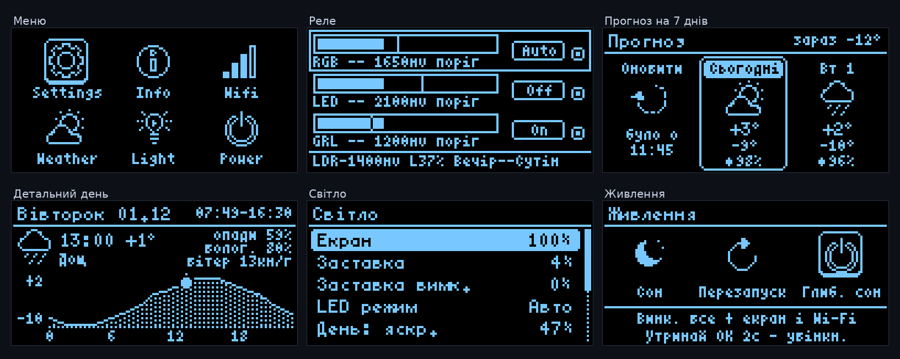

# ⚡ ESP32 Home Controller

Контролер домашнього освітлення на **ESP32** з OLED-екраном, трьома реле, адресною LED-стрічкою,
контролем акумуляторів і живлення, погодою на 7 днів і власним **веб-меню**.
Кнопки, енкодер, ІЧ-пульт і стрічку обслуговує окрема **Arduino Pro Micro**, яка спілкується з ESP32 по UART.



## Можливості

- **Автоматичне світло:** три реле (RGB, LED, гірлянда) вмикаються від фоторезистора. У кожного свій поріг, затримка від миготіння і режим Авто / Вимк / Увімк.
  - **За сонцем:** удень (від сходу до заходу за прогнозом) «Авто» реле не вмикає.
  - **Нічне вимкнення:** вибрані реле гаснуть із заданої години.
  - **Автокалібрування фоторезистора:** шкала підлаштовується сама. Слово освітленості (Темно / Сутінки / Світло / Яскраво) стрибає одразу, без «перебігання». Межі слів можна задати вручну у вольтах (за замовчуванням Темно < 1,0 В, Сутінки < 1,7 В, Світло < 2,3 В) або взяти автоматично з калібрування.
- **Живлення:** два акумулятори та лінія 5 V через INA3221, датчик «світло є / нема» в домі.
- **Погода Open-Meteo** без ключів:
  - поточна раз на 10 хв;
  - прогноз на 7 днів погодинно (температура, опади, вологість, вітер) раз на 3 год;
  - прогноз зберігається у флеш, тож погода є і без інтернету.
- **Точний годинник:** NTP. Без інтернету прошивка сама компенсує похибку кварцу (вимірює її в ppm).
- **Інтерфейс на OLED 128×64:**
  - головний екран, екран реле, меню з шести пунктів;
  - плавні анімації: рамки-курсори «перетікають», режими виїжджають, підменю розгортаються, сповіщення спливають;
  - заставка з рухомою галактикою, щоб екран не вигорав.
- **Веб-меню** (телефон або ПК): усі стани й налаштування, графік прогнозу, вибір мережі Wi-Fi зі сканером.
- **Живий екран у браузері:** трансляція OLED і пульт (енкодер, OK, BACK, CONF, коліщатко миші, клавіатура) внизу «Огляду». Вмикається перемикачем «Керування дисплеєм», вибір зберігається на платі. Плата шле лише змінені шматки екрана, тож нерухомий екран мережу не навантажує.
- **Плавні 40 к/с** (можна 60): кадр передається великими пакетами і лише змінені смуги. Трансляція у веб-меню — ~30 к/с. Переходи між екранами — «картки» з пружинним дотягуванням, паралаксом і растровим розчиненням.
- **Точка доступу:** власна, вмикається вручну, а якщо мережі нема — автоматично. Тоді веб-меню відкривається за адресою `192.168.4.1`.
- **Живлення пристрою:** сон (як кнопка CONF), перезапуск і глибокий сон. У глибокому сні вимкнено все, навіть екран і Wi-Fi; увімкнути — утримати OK 2 с.
- **Оновлення прошивки по повітрю (OTA).**

## Залізо

| Модуль | Призначення |
|---|---|
| ESP32 DevKit (esp32dev) | основна плата |
| OLED SH1106 128×64, I2C | екран |
| INA3221 | напруга 2 АКБ і лінії 5 V |
| Фоторезистор + резистор (дільник) | освітленість |
| 3 реле через NPN-транзистори | RGB, LED, гірлянда |
| Arduino Pro Micro | енкодер, кнопки BACK / CONF / OK, ІЧ-приймач, WS2812 |
| Дільник від мережевого БЖ | датчик «світло в домі» |

### Піни ESP32

| Пін | Що підключено |
|---|---|
| 21 / 22 | I2C SDA / SCL (OLED, INA3221) |
| 16 / 17 | UART RX / TX ↔ Pro Micro (TX / RX) |
| 25 / 26 / 27 | реле 1 (RGB) / реле 2 (LED) / реле 3 (гірлянда) |
| 34 | фоторезистор (АЦП) |
| 35 | датчик світла в домі (≥ 1 В = світло є) |

Канали INA3221: **1** лінія 5 V, **2** резервний акумулятор, **3** основний. Усе змінюється на початку `src/main.cpp`.

### Піни Pro Micro

| Пін | Що підключено |
|---|---|
| 0 / 1 | UART RX / TX ↔ ESP32 (17 / 16) |
| 3 / 7 | енкодер A / B |
| 8 / 2 / 4 | кнопки BACK / CONF / OK |
| 9 | ІЧ-приймач (NEC) |
| 10 | дані WS2812 |

## Швидкий старт

Потрібен [PlatformIO](https://platformio.org/) (VS Code або CLI).

1. **Особисті дані.** Скопіюйте шаблони і впишіть свої значення:
   ```bash
   cp include/secrets.example.h include/secrets.h   # Wi-Fi, пароль OTA, точка доступу, координати
   cp secrets.example.ini secrets.ini               # пароль OTA для завантаження
   ```
   Обидва файли в `.gitignore`. Wi-Fi можна лишити порожнім і вибрати мережу потім у веб-меню.

2. **Перша прошивка ESP32 по кабелю:**
   ```bash
   pio run -e usb -t upload
   ```
3. **Наступні прошивки — по Wi-Fi:**
   ```bash
   pio run -t upload            # env:ota, адреса esp32-test.local
   ```
4. **Pro Micro:**
   ```bash
   cd promicro && pio run -t upload
   ```

## Керування

| Де | Крутилка | OK | BACK |
|---|---|---|---|
| Головний екран | гортати екрани | режим RGB | — |
| Екран реле / меню (рамка по краю) | гортати екрани | зайти | на головний |
| Вибір реле / пункту меню | рухати рамку | вибрати / відкрити | вийти |
| Вибране реле | поріг | Авто → Вимк → Увімк | зберегти й вийти |
| Список у меню | рядок / значення | правити / зберегти | зберегти / назад |

- **CONF** вимикає все й вмикає заставку, повторне натискання повертає. Стан переживає перезапуск.
- **ІЧ-пульт:** `0x45` увімкнути все, `0x47` вимкнути все. Щоб чужі пульти з тими самими кодами не спрацьовували, задайте адресу свого пульта в `IR_ADDR` (`src/main.cpp`). Адресу видно в останній події ІЧ-пульта: `IR,NEC,0x..,0x..`.
- **Утримати OK 2 с** — вийти з глибокого сну.

### Меню

- **Settings:** сон екрана, затримка реле, калібрування LDR, «За сонцем», нічне вимкнення.
- **Info:** усі датчики, стани й системна інформація.
- **Wifi:** мережа, якість сигналу, IP, точка доступу.
- **Weather:** картки на 7 днів, кнопка «Оновити», погодинний графік обраного дня.
- **Light:** яскравість екрана й заставки, LED-стрічка (режим, яскравість і ефект для дня й темряви) з живим попереднім переглядом.
- **Power:** сон, перезапуск, глибокий сон.

## Веб-меню

Адреса: `http://esp32-test.local`, IP плати або `http://192.168.4.1` через точку доступу ESP32.

Вкладки:
- **Огляд** — погода, електрика, освітленість, швидкі дії;
- **Реле** — режим і поріг кожного, з живою рискою освітленості на шкалі;
- **Світло** — LED-стрічка й яскравість екрана;
- **Погода** — 7 днів, графік температури й опадів, погодинна таблиця;
- **Налаштування** — зокрема **вибір мережі Wi-Fi**: пошук мереж, вибір і пароль. Пробіли на краях назви й пароля прибираються автоматично;
- **Система** — інформація, сон, перезапуск, глибокий сон.

API (JSON):
- `GET /api/state` — усі стани;
- `GET /api/fc` — прогноз;
- `GET /api/set?k=…&v=…` — змінити налаштування;
- `GET /api/act?a=wx|restart|alloff|allon|deep|calreset` — дії;
- `GET /api/scan` — пошук мереж;
- `GET /api/screen` — поточний кадр екрана (1024 байти);
- `GET /api/key?k=left|right|ok|back|conf|wake|sleep` — пульт;
- `POST /api/wifi` — вибір мережі.

> Веб-меню не має пароля. Використовуйте його лише в довіреній домашній мережі.

## Емулятор інтерфейсу

Справжня прошивка (`src/main.cpp`) збирається для ПК і працює у вікні, без плати: усі екрани, меню, анімації, налаштування.

```bash
pio run                       # один раз, щоб скачалась бібліотека U8g2
python3 emulator/emulator.py  # сам перезбирає емулятор, коли змінюється прошивка
```

Потрібні `g++` і Python 3 з tkinter.

- **Миша над екраном:** коліщатко — крутилка, ліва — OK (утримати 2 с — вийти з глибокого сну), права — BACK, середня — CONF.
- **Клавіатура:** ← → ↑ ↓ — крутилка, Enter — OK, Esc — BACK, пробіл — CONF.
- **Праворуч:** «датчики» (фоторезистор, світло в домі, акумулятори, лінія 5V, Wi-Fi), стан реле і колір LED-стрічки.
- **Налаштування** зберігаються в `emulator/emu_prefs.txt`.
- **Погода** в емуляторі тестова, бо інтернету в ньому нема.

Залізо ESP32 імітує `emulator/shim/emu_hal.h`: I2C з дисплеєм та INA3221, UART до Pro Micro, NVS, Wi-Fi, FreeRTOS.

## Протокол ESP32 ↔ Pro Micro (UART 115200)

Від Pro Micro приходять події, у відповідь ESP32 надсилає команди:

```
ENC,+1 | ENC,-1                       # оберт енкодера
BTN,OK|BACK|CONF,1|0                  # натиснута / відпущена кнопка
IR,<протокол>,0x<адреса>,0x<команда>   # кнопка пульта
READY,PROMICRO,<версія>               # Pro Micro запустилась

LED,r,g,b | LED,OFF                   # колір стрічки (ефекти рахує ESP32)
LEDS,n | BRIGHT,n | PX | FILL | SHOW | FRAME,<hex>
EVENTS,ENC|BTN|IR,0|1 | VER | PING | STATUS | HELP
```

Повний список команд — на початку `promicro/src/main.cpp`.

## Структура

```
src/main.cpp            прошивка ESP32 (екрани, логіка, погода, веб)
src/web_page.h          веб-меню (HTML/CSS/JS в одному рядку PROGMEM)
include/secrets.example.h  шаблон особистих даних
promicro/               прошивка Arduino Pro Micro
emulator/               емулятор інтерфейсу для ПК (python3 emulator/emulator.py)
partitions.csv          розділи з двома слотами для OTA
```
